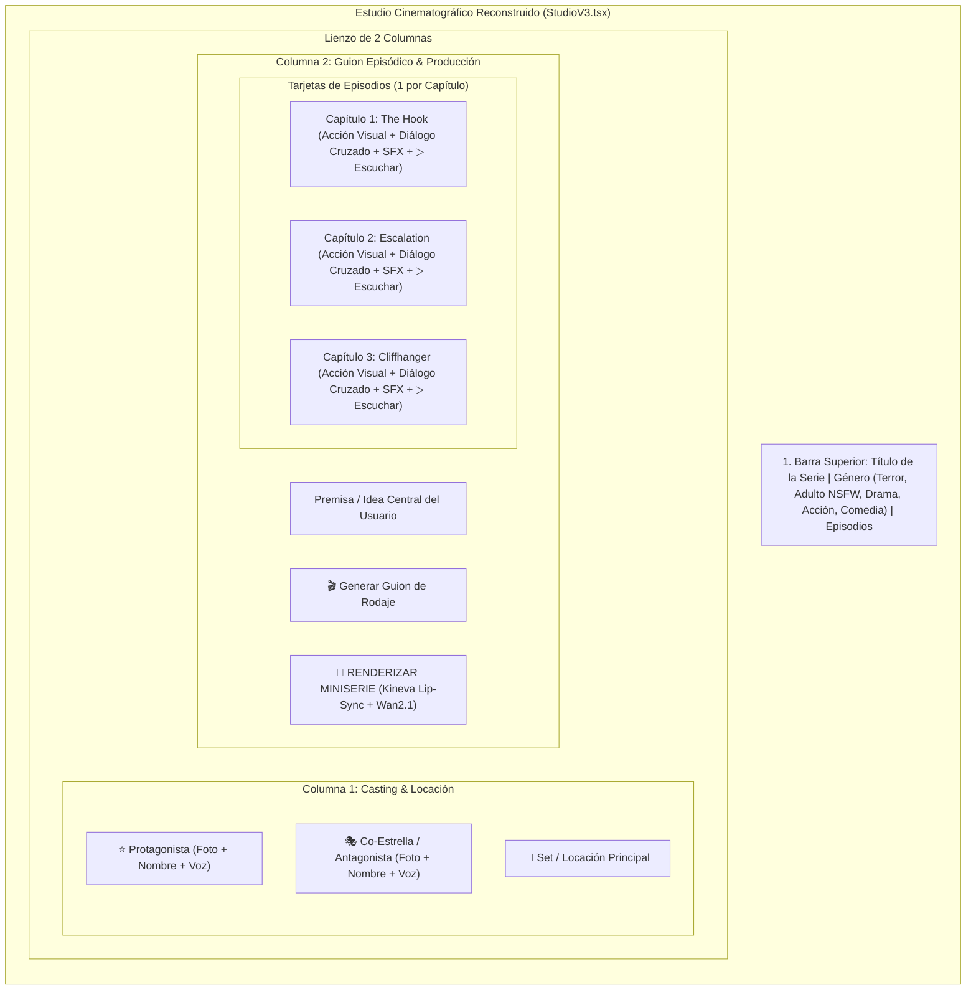

# ARQUITECTURA MAESTRA DE RECONSTRUCCIÓN: ESTUDIO CINEMATOGRÁFICO DE MINISERIES (V3)
## BENCHMARK INDUSTRIAL: CANDY SHORTS (ADULTO/NSFW), REELSHORT, DRAMABOX, RUNWAY & HEYGEN

> **Objetivo:** Reconstruir el Estudio desde CERO, eliminando todo código sobrepuesto, formularios técnicos redundantes y prompts envenenados, para implementar la arquitectura probada y exitosa que lidera la industria del micro-drama vertical (9:16) en todos los géneros.

---

## 1. BENCHMARK INDUSTRIAL POR GÉNERO Y FORMATO

### A. CANDY SHORTS / CANDY.AI (LÍDER EN ADULTO & NSFW)
Candy.ai transformó el roleplay de texto tradicional en **Candy Shorts**, micro-dramas verticales episódicos (60 a 90 segundos) de altísimo enganche visual y sensorial:
1. **Dinámica Narrativa (Tropes & Taboo):**
   - Conflictos basados en proximidad forzada, dinámicas de poder (jefe/empleada, inquilinos, romance prohibido), celos y tensión sexual acumulada.
   - Pacing: Comienza con un momento de contacto visual o roce físico inesperado (0-10s), escala con provocaciones y respiraciones pesadas (10-50s) y culmina en un cliffhanger de clímax erótico o interrupción inminente (50-80s).
2. **Tratamiento Acústico y Sensorial:**
   - No hay monólogos planos ni locución de radio: la voz neural utiliza modulación de susurro (*whisper*), pausas jadeadas, gemidos sutiles y ecos de alcoba.
   - Foley acústico: Sonido de prendas deslizándose, sábanas, lluvia exterior tenue, respiración en el micrófono.
3. **Flujo de Estudio en Candy Shorts ("Build Your Video"):**
   - **Paso 1: Selección del Avatar / Personaje:** Catálogo visual limpio de acompañantes. 1 clic bloquea la cara del personaje principal.
   - **Paso 2: Set y Atmósfera:** Selección de iluminación tenue (velas, neón de hotel, ático nocturno, dormitorio).
   - **Paso 3: Guion & Diálogo Íntimo:** Frases breves, sugerentes y de doble sentido, con indicaciones físicas de contacto corporal.

---

### B. REELSHORT & DRAMABOX (LÍDERES EN TERROR, SUSPENSO, DRAMA Y ACCIÓN)
Ambas aplicaciones facturan decenas de millones de dólares al mes basándose en el **Esqueleto de 3 Pulsos por Minuto**:
1. **Estructura Estricta de 90 Segundos:**
   - **Beat 1: The Hook (0-5s):** Acción física en seco. No hay planos de establecimiento lentos. Arranca con un grito, una huida a pie o una bofetada.
   - **Beat 2: The Turn & Escalation (5-60s):** Diálogo cruzado urgente (máximo 12 a 15 palabras por réplica). Personaje A y Personaje B se responden mutuamente mientras el peligro se acerca.
   - **Beat 3: The Cliffhanger (60-90s):** Corte abrupto en el segundo de mayor impacto (ej. la criatura arrinconando a la víctima o la puerta que no abre).
2. **Cero Plantillas Hardcodeadas:** Cada género tiene su propia gramática de cámara:
   - *Terror:* Cámara en mano vibrante (`Handheld Shake`), planos holandeses, sombras chinescas, iluminación claroscuro.
   - *Acción:* Cortes rápidos, tracking shots, planos detalle de impacto.
   - *Drama / Romance:* Primeros planos profundos (`Depth of field`), miradas intensas, iluminación cálida.
   - *Comedia:* Planos medios estables, timing de remate visual y pausas incómodas.

---

### C. INVIDEO AI, RUNWAY GEN-3 & HEYGEN (EL ESTÁNDAR DE UX DEL ESTUDIO)
El error fatal de nuestro estudio actual era mostrarle al usuario un formulario de base de datos con 50 inputs y subtomas. Las herramientas top hacen exactamente lo contrario:
1. **Lienzo Dividido en 2 Columnas (Two-Pane Studio):**
   - **Panel Izquierdo (Hub de Casting & Set):** Tarjeta visual del Protagonista, tarjeta del Co-Protagonista/Antagonista y Locación.
   - **Panel Derecho (Timeline de Guion & Render):** Tarjetas verticales para cada Capítulo con su toma, diálogo hablado, audio neural y botón de render.
2. **El "Character Lock" (Cero Fallas de Galería):**
   - Al tocar la ranura de personaje, un modal abre dos pestañas:
     - *📁 Galería del Estudio:* Muestra todas las fotos guardadas. Al tocar cualquier foto, se selecciona y se marca con un borde verde/dorado `LOCKED`.
     - *💻 Subir desde PC / Crear:* Para importar una foto nueva o generar un rostro desde cero con IA.
3. **Control Escena por Escena:**
   - Posibilidad de reproducir la voz de cada capítulo con `▷ Escuchar` antes de renderizar el video.
   - Si no gusta el Capítulo 2, se regenera únicamente ese capítulo sin alterar los demás.

---

## 2. LA NUEVA ARQUITECTURA DEL ESTUDIO DE MINISERIES (RECONSTRUCCIÓN DE CERO)

---

## 3. ESPECIFICACIÓN POR CATEGORÍA EN EL MOTOR DE GUIONES

El motor en el servidor (`api/ai.mjs`) se reescribe para aplicar directores virtuales especializados según el género seleccionado:

| Género | Director Virtual | Dinámica de Cámara & Blocking | Diálogos & Audio Neural | Foley & SFX |
| :--- | :--- | :--- | :--- | :--- |
| **Terror / Suspenso** | *Estilo James Wan / Mike Flanagan* | Cámara en mano con vibración orgánica, sombras profundas, primeros planos de ojos dilatados, huidas en plano secuencia. | Susurros entrecortados, advertencias desesperadas, frases cortas (<10 palabras). | Crujidos de madera/ramas, respiración en el micrófono, rugidos guturales, violines tensos. |
| **Adulto / NSFW** | *Estilo Candy Shorts / Erotic Thriller* | Iluminación de baja clave (claroscuro, neón, velas), planos detalle de labios, cuellos y manos, roces corporales intensos. | Voces neurales susurradas, jadeos sutiles, provocaciones íntimas, silencios cargados. | Prendas deslizándose, lluvia en la ventana, suspiros cercanos, latidos rítmicos. |
| **Drama / Romance** | *Estilo ReelShort / DramaBox* | Profundidad de campo cinematográfica con desenfoque de fondo (bokeh), miradas directas, contraplanos fluidos. | Declaraciones emocionales punzantes, reproches, secretos revelados, tensión romántica. | Piano melancólico, ambiente urbano elegante, ecos suaves. |
| **Acción / Thriller** | *Estilo John Wick / Extraction* | Planos dinámicos en ángulo bajo, movimientos rápidos de seguimiento lateral, impactos físicos directos. | Órdenes tácticas, gritos de combate, desafíos directos. | Golpes secos, derrapes, metal chirriante, percusión acelerada. |
| **Comedia** | *Estilo Micro-Sitcom Vertical* | Planos medios nítidos, cortes secos para remates cómicos, miradas de complicidad a cámara. | Timing cómico, ironía, malentendidos absurdos, respuestas rápidas. | Silencios incómodos de repente, efectos de sonido caricaturescos o foley cotidiano. |

---

## 4. PLAN DE RECONSTRUCCIÓN PASO A PASO (SIN PARCHES)

Para garantizar que no queden códigos viejos que causen interferencias:

1. **Fase 1: Motor Showrunner Pro en Backend (`api/ai.mjs`):**
   - Eliminar por completo el prompt viejo con ejemplos de "vehículos".
   - Crear el generador multi-género con soporte completo para Candy Shorts (NSFW), Terror, Drama, Acción y Comedia.
   - Salida obligatoria: Desglose cinematográfico de cámara + Diálogo interactivo entre Protagonista y Co-Estrella + Pista de Efectos Sonoros (SFX).

2. **Fase 2: Componente Modal "Character Hub" (`src/components/studio/CharacterModal.tsx`):**
   - Modal limpio con 2 pestañas:
     - 📁 **Mi Elenco:** Grid de fotos con selección instantánea al tocar la imagen, borde de selección activo y nombre editable.
     - 💻 **Subir / Generar:** Subida directa sin errores.
   - Asignación transparente al Protagonista o Antagonista.

3. **Fase 3: Estudio Reconstruido de Cero (`StudioV3.tsx`):**
   - Eliminar los bloques sobrepuestos ("Editor Avanzado de Subtomas", "Directores de Poses", "Acordeones gigantes").
   - Interfaz en 2 columnas estilo InVideo / HeyGen.
   - Tarjetas de capítulos claras y directas con botón `▷ Escuchar Voces` y botón de `Regenerar toma`.

4. **Fase 4: Pipeline de Render y Pruebas Reales:**
   - Verificación de la historia de terror en el bosque (huida, persecución de la figura macabra, asfalto salvador).
   - Verificación de una miniserie Candy Shorts NSFW (atmósfera íntima, voces susurradas, tensión erótica).
