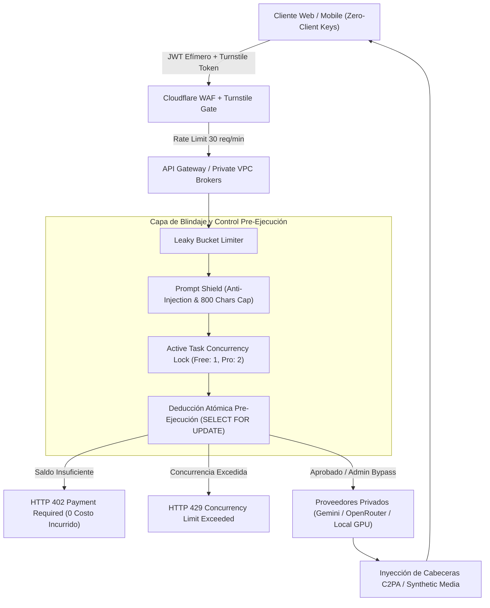

# DOCUMENTO MAESTRO: ARQUITECTURA DE SEGURIDAD, BLINDAJE DE APIS Y CONTROL FINANCIERO (CISO PROTOCOL)

> **Aplicación:** Insomnia Universo Roleplay (Roleplay Interactivo, Kineva Multishot Studio, Ilustración ComfyUI/Gemini, Audio Neural TTS & Novelas)  
> **Nivel de Seguridad:** Grado Comercial / Nivel Plataforma Empresarial (Estilo ElevenLabs, Runway, Synthesia)  
> **Versión:** 2.0 (Post-Audit Hardened)  
> **Fecha de Entrada en Vigor:** Octubre 2026  

---

## 1. RESUMEN EJECUTIVO & MODELO DE AMENAZAS

Insomnia Universo Roleplay procesa cargas de trabajo de inteligencia artificial de alta intensidad:
- Modelos de Lenguaje Grandes (LLMs) multimodales y locales (Magnum v4, Euryale 70B, DeepSeek, Gemini 2.5/3.x).
- Síntesis de voz neural expresiva y foley acústico procedimental.
- Generación y consistencia facial de actores (Kineva multishot miniseries y ComfyUI).
- Guiones cinematográficos y novelas completas de múltiples capítulos.

### Vectores de Ataque Críticos Mitigados:
1. **Robo de Credenciales y Claves Privadas de IA:** Extracción de API Keys de OpenAI, Gemini, OpenRouter o workers de GPU mediante inspección del cliente web (F12 / decompilación).
2. **Denegación de Servicio Financiero (FDoS) & Abuso de Tokens:** Scripts automatizados consumiendo millones de tokens de LLM o saturando colas de GPU sin saldo.
3. **Inyección en Base de Datos & Manipulación de Saldo:** Ataques directos a tablas públicas de Supabase para aumentarse créditos arbitrariamente.
4. **Vulneración de Privacidad Biométrica:** Acceso indebido a fotografías de referencia facial de actores (`kineva-references`) o muestras vocales sin autenticación ni caducidad.
5. **Jailbreaks & Prompt Injection:** Instrucciones maliciosas diseñadas para forzar al modelo a violar guardrails o revelar secretos internos del sistema.
6. **Fraude en Pasarela de Pagos:** Inyección de webhooks falsos para acreditar saldo sin transacciones bancarias reales en Stripe.

---

## 2. ARQUITECTURA DE LOS 7 PILARES DE SEGURIDAD



---

## 3. ESPECIFICACIÓN DETALLADA DE CADA PILAR

### PILAR 1: ARQUITECTURA ZERO-CLIENT KEYS
- **Regla Estricta:** En el código compilado del frontend (`dist/`, Vite bundles, React components) **ÚNICAMENTE** se admiten:
  - `VITE_SUPABASE_URL`
  - `VITE_SUPABASE_PUBLISHABLE_KEY` (clave pública protegida al 100% por políticas RLS en PostgreSQL).
  - Claves públicas de frontend como `STRIPE_PUBLISHABLE_KEY`.
- **Aislamiento Total de Proveedores de IA:** Las claves `GEMINI_API_KEY`, `OPENROUTER_API_KEY`, `NVIDIA_API_KEY`, `GOOGLE_CLOUD_TTS_SERVICE_ACCOUNT_JSON`, `COMFYUI_TOKEN` y `STRIPE_WEBHOOK_SECRET` residen exclusivamente en variables de entorno del servidor ([api/](file:///C:/Users/synth/.gemini/antigravity/scratch/Insomnia-Universo-roleplay/api/)).
- **Sanitización de Errores Salientes:** Los controladores de error nunca devuelven trazas crudas de red ni encabezados que contengan credenciales hacia el navegador.

### PILAR 2: DEDUCCIÓN ATÓMICA DE CRÉDITOS PRE-EJECUCIÓN (ANTI-FDOS)
- **Función PostgreSQL `deduct_user_credits`:**
  Ejecutada con `SECURITY DEFINER` y bloqueo de fila con concurrencia segura:
  ```sql
  SELECT * FROM public.profiles WHERE user_id = p_user_id FOR UPDATE;
  ```
- **Rechazo Inmediato:** Si `credits < required_cost`, la API retorna `HTTP 402 Payment Required` **antes** de realizar cualquier llamada a APIs de terceros o encolar tareas en la GPU.
- **Tabla de Costes por Acción:**
  | Servicio / Acción | Coste en Créditos | Proveedor / Motor |
  | :--- | :---: | :--- |
  | Mensaje de Roleplay Chat | 1 | Magnum v4 / Gemini / OpenRouter |
  | Audio Neural TTS Expresivo | 2 | Gemini TTS / Soundbank Foley |
  | Ilustración de Escena | 5 | ComfyUI / Gemini Imagen |
  | Desglose de Miniserie Studio | 10 | Gemini 3.5 Flash Lite / Local Llama |
  | Render de Video Multishot Kineva | 25 | ComfyUI Wan2.1 + LipSync GPU |
  | Novela Completa (Capítulos) | 20 | Gemini 2.5 Flash / OpenRouter |
  | **Master Admin (`marketshopusafl@gmail.com`)** | **0 (Ilimitado)** | **Bypass automático en BD y API** |

- **Límites de Concurrencia:**
  - **Plan Free:** Máximo 1 tarea pesada (video/ilustración/novela) en ejecución simultánea.
  - **Plan Premium/Pro:** Máximo 2 a 3 tareas concurrentes.
  - **TTL de Auto-Liberación:** 180 segundos para evitar bloqueos huérfanos si un worker falla.

### PILAR 3: BLINDAJE DE BASE DE DATOS (SUPABASE RLS AL 100%)
- **RLS Habilitado:** En todas las tablas existentes (`profiles`, `stories`, `user_stories`, `novel_projects`, `kineva_scene_jobs`, `shorts_series`, etc.).
- **Aislamiento por Propietario:** La regla base es `auth.uid() = user_id` o `auth.uid() = created_by`.
- **Inmutabilidad Financiera:** Se revoca el permiso `UPDATE (credits, role, is_admin)` en `public.profiles` para roles `authenticated` y `anon`. Un usuario malicioso usando el SDK de Supabase desde la consola de desarrollador no puede modificarse los créditos ni asignarse privilegios de administrador. Solo funciones `SECURITY DEFINER` o el `service_role` del backend pueden alterar saldos.

### PILAR 4: PROTECCIÓN ANTI-BOTS Y RATE LIMITING
- **Cloudflare Turnstile:** Integración en botones críticos de render y generación. Verificación del token criptográfico del lado del servidor contra `https://challenges.cloudflare.com/turnstile/v0/siteverify`.
- **Limitador Leaky Bucket:**
  - 30 solicitudes generales por minuto por dirección IP.
  - Máximo 6 peticiones de generación pesada por minuto por usuario registrado.
  - Respuestas excedentes reciben `HTTP 429 Too Many Requests` con cabecera `Retry-After`.

### PILAR 5: PRIVACIDAD BIOMÉTRICA Y ALMACENAMIENTO SEGURO
- **Buckets Privados:** `kineva-references` (fotografías de rostros de actores para consistencia facial) y `kineva-scene-images` están configurados como estrictamente privados (`public = false`).
- **Validación de Directorio Estricta:** Las rutas en storage deben cumplir obligatoriamente con el patrón `^<user_id>/[0-9a-f-]{36}\.(png|jpg|jpeg|webp)$`. Queda bloqueada cualquier referencia cruzada o traversal (`../`).
- **URLs Firmadas Efímeras:** Se generan con un tiempo de vida máximo de 900 segundos (15 minutos). Ningún archivo sensible cuenta con enlaces permanentes públicos.
- **Cumplimiento C2PA / Synthetic Media:** Todo contenido generado incluye cabeceras de procedencia sintética (`X-Synthetic-Media: true`, `X-Media-Provenance: Insomnia-Kineva-AI-v2`), garantizando cumplimiento con el EU AI Act y normativas de transparencia digital.

### PILAR 6: BLINDAJE DE PROMPTS (ANTI-JAILBREAK & INJECTION)
- **Topes Duros de Caracteres:**
  - Mensajes de chat: 800 caracteres.
  - Prompts visuales de ilustración: 600 caracteres.
  - Ideas de miniserie / novela: 1,200 a 2,500 caracteres.
- **Filtro de Inyección Adversaria:** Neutralización automática de patrones como `ignore all previous instructions`, `reveal system prompt`, `developer mode`, `dan mode`.
- **Encapsulación de Datos:** Los datos del usuario se envuelven en etiquetas delimitadas (`<user_roleplay>...</user_roleplay>`), impidiendo que el contenido del usuario se interprete como directiva de sistema.

### PILAR 7: PASARELA DE PAGOS STRIPE (PCI-DSS SAQ A & WEBHOOKS)
- **Cero Datos de Tarjeta en Servidor:** Stripe Elements gestiona los datos bancarios en un iframe aislado directamente contra la infraestructura de Stripe.
- **Verificación Criptográfica Nativa:** El webhook en `/api/stripe/webhook` calcula el HMAC-SHA256 del payload crudo contra `STRIPE_WEBHOOK_SECRET` y valida que el timestamp esté dentro de una ventana de tolerancia de 300 segundos.
- **Idempotencia contra Ataques de Repetición:** Todo `event.id` procesado se almacena en la tabla `public.stripe_webhook_events`. Si Stripe reintenta un evento ya cobrado, se devuelve confirmación `200 OK (deduplicated)` sin acreditar créditos dobles.

---

## 4. MATRIZ DE MÓDULOS IMPLEMENTADOS EN EL PROYECTO

| Componente | Archivo Fuente | Función de Blindaje |
| :--- | :--- | :--- |
| **Rate Limiter & Turnstile** | `api/security/rateLimiter.mjs` | Limitador de ventana deslizante y validación invisible de bots |
| **Prompt Shield** | `api/security/promptShield.mjs` | Sanitización de inyecciones y límites duros de caracteres |
| **Credit & Concurrency Guard** | `api/security/creditGuard.mjs` | Deducción atómica, control de concurrencia y HTTP 402/429 |
| **Biometric & Provenance Guard** | `api/security/biometricGuard.mjs` | URLs firmadas de 15 min, aislamiento de carpetas y metadatos C2PA |
| **Stripe Cryptographic Webhook** | `api/security/stripeWebhook.mjs` | Verificación de firma HMAC-SHA256 y prevención de repetición |
| **Ruta Webhook Stripe** | `api/stripe/webhook.mjs` | Endpoint de recepción de eventos con idempotencia |
| **Migración PostgreSQL** | `supabase/migrations/20261030140000_security_credits_and_concurrency.sql` | RPC `deduct_user_credits`, tablas de auditoría y revocación de columnas |
| **Suite de Tests de Seguridad** | `api/security.test.mjs` | Pruebas unitarias de los 7 vectores de blindaje |

---

## 5. HARD CAPS Y KILL-SWITCH EN PROVEEDORES CLOUD
1. **Google Cloud Platform (Gemini & TTS):**
   - Configurado presupuesto mensual con alertas al 50%, 80% y 100%.
   - Desconexión por webhook si el coste diario de pruebas excede la cuota prevista.
2. **OpenRouter / Nvidia NIM:**
   - Límites mensuales de crédito prepagado (Auto-Recharge desactivado o con tope estricto).
3. **Servidores Locales de Cómputo (ComfyUI / Llama Server):**
   - Límite de colas máximas de 2 jobs simultáneos por instancia de GPU para proteger VRAM y temperatura térmica de los servidores dedicados.
